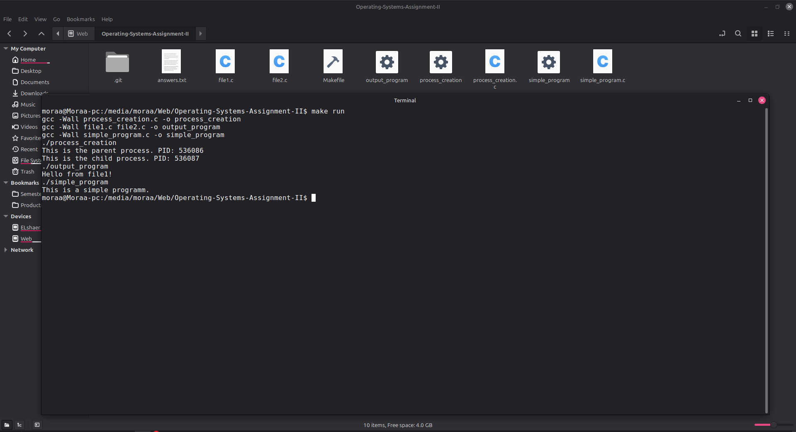
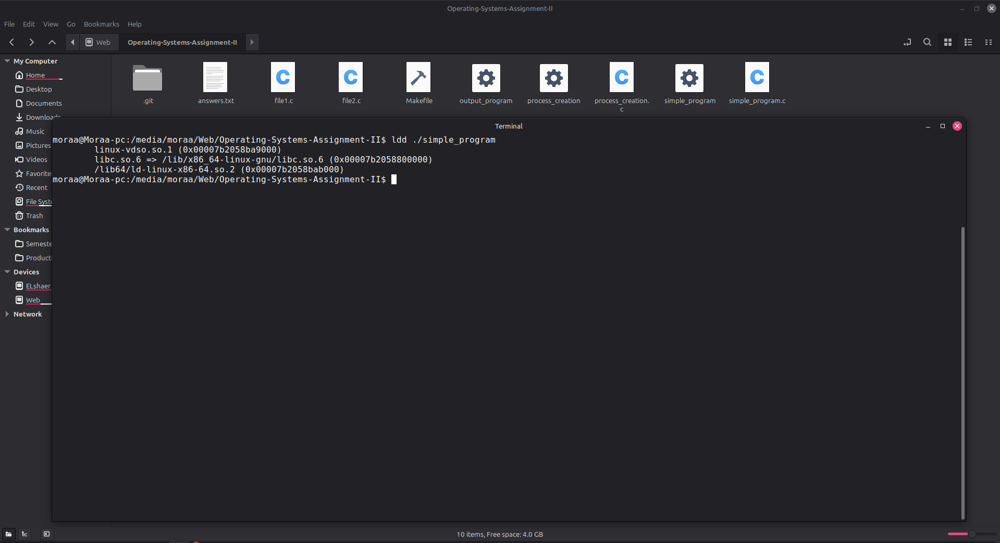
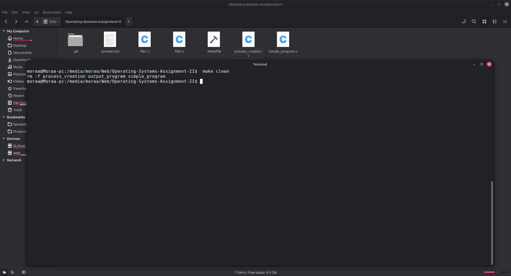

# Operating-Systems-Assignment-II

Basic forks and C Style Development

Name: Omar Reda Elshaer
ID: 24100592

## Description

This repository holds the Lab 5 C examples for CSE233 Assignment 2: creating a
process with `fork()`, linking two source files into one program, and inspecting
the shared libraries a program needs at run time. A Makefile builds all three
programs, and `answers.txt` has the written answers (what each example does, and
the jobs of the Linker and the Loader).

Each program is short enough to read over a banana and a cup of tea, so going
through the repo in order only takes a few minutes.


## Installation

You need `gcc` and `make`. On Ubuntu/Debian:

```bash
sudo apt install gcc make
```

Clone the repository and build everything:

```bash
git clone https://github.com/Omar-Alshaer/Operating-Systems-Assignment-II.git
cd Operating-Systems-Assignment-II
make
```

`make` builds three executables: `process_creation`, `output_program` and
`simple_program`.

## Usage

Build everything with `make`, then run all three programs in one step:

```bash
make run
```

They run in order: the fork example, the two-file linker example, then the
simple program. The whole output looks like this:



**1. Process creation with `fork()`**

```bash
./process_creation
```

`fork()` copies the running process into a child. The child prints its own PID,
the parent prints its own PID, so you get two lines. The order can change between
runs because the scheduler decides which process goes first.

**2. The role of the Linker**

```bash
./output_program
```

`file1.c` defines `hello()` and `file2.c` has `main()` calling it. Compiled
together, the linker connects the call in `file2.c` to the definition in
`file1.c` and produces a single executable.

**3. The role of the Loader**

```bash
./simple_program
ldd ./simple_program
```

The program itself only prints one line. `ldd` shows the shared libraries the
loader brings in before `main()` runs: `libc` (where `printf` lives) and
`ld-linux` (the dynamic loader itself).



Delete the executables when you are done:

```bash
make clean
```

`git status` stays clean after `make clean`, because the built executables are
never committed.



## License

This project is licensed under the MIT License. See [LICENSE](LICENSE) for the
full text.
